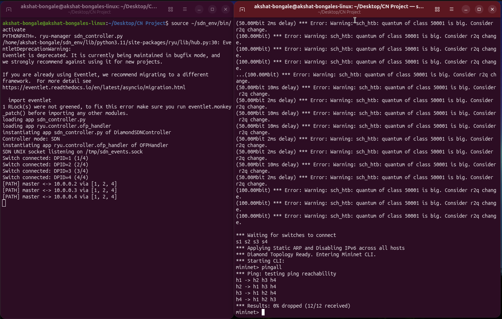
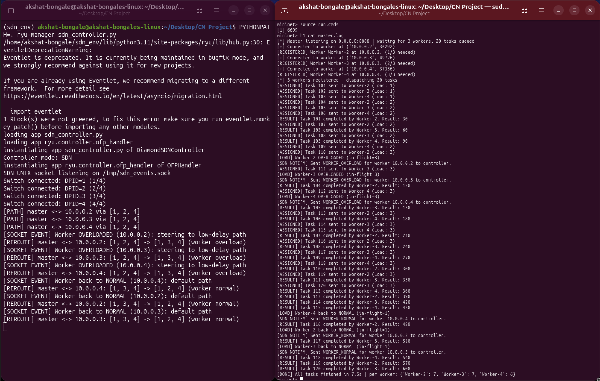
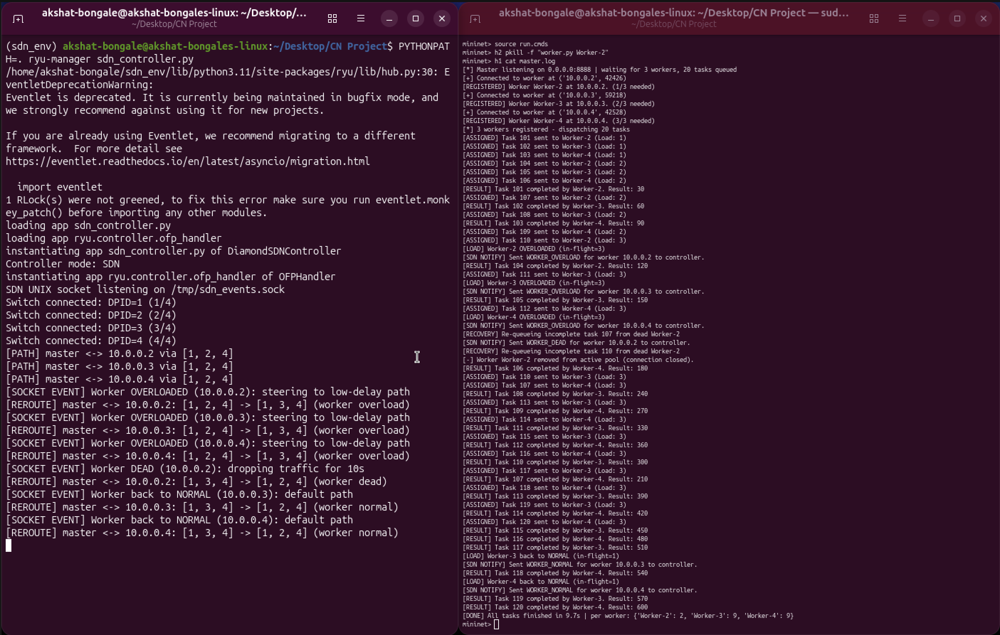
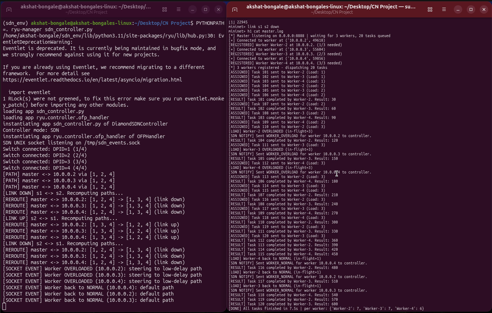
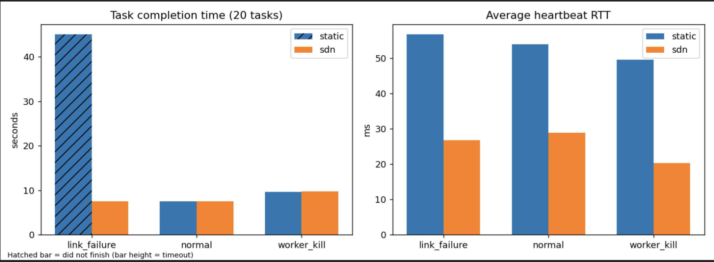

# Project 29 — Distributed Task Notification and Worker System

**Computer Networks (UE25CS243A) · PES University · Team 22, Section A**

A master server distributes tasks to worker nodes over TCP sockets inside a Mininet diamond network.
A custom Ryu (OpenFlow 1.3) SDN controller reacts to application events and network failures in real time.

---

## Team

|         Name          |      SRN      |
|-----------------------|---------------|
| Akshat Jayesh Bongale | PES2UG25CS045 |
| Amrish Venkatesan     | PES2UG25CS060 |
| Akash Chalawadi       | PES2UG25CS044 |

---

## Architecture

```
          MASTER (h1 · 10.0.0.1)
               | TCP :8888
    +----------+----------+
    |          |           |
 Worker-2   Worker-3   Worker-4       UNIX socket /tmp/sdn_events.sock
(h2)        (h3)        (h4)                    |
                                        RYU CONTROLLER
              s1 --[Path A 20ms]--> s2 --+
              |                          +--> s4 --> h2, h3, h4
              +--[Path B  4ms]--> s3 --+
```

**Files**

|        File         |                                  Purpose                                      |
|---------------------|-------------------------------------------------------------------------------|
| `master.py`         | TCP server — scheduler, heartbeat monitor, task-timeout monitor, SDN notifier |
| `worker.py`         | TCP client — registers, processes tasks, sends heartbeats with RTT            |
| `topology.py`       | Mininet diamond topology — 4 switches, 4 hosts, TCLink delays                 |  
| `sdn_controller.py` | Ryu controller — proactive flows, rerouting, load-aware steering, quarantine  |
| `benchmark.py`      | Automated static vs SDN benchmark — outputs `results/`                        |
| `run.cmds`          | Mininet CLI script — starts master + 3 workers                                |     


---

## Setup

See [SETUP.md](SETUP.md) for the full environment recipe (Mininet, Python 3.11 venv, Ryu 4.34).

---

## Running the demo

> **Always run `sudo mn -c` first** — it cleans up stale Mininet state but also kills `ryu-manager`,
> so Ryu must be started after it.

```bash
# 1. Clean up
sudo mn -c

# 2. Start controller (Terminal 1 — leave it running)
source ~/sdn_env/bin/activate
ryu-manager sdn_controller.py

# 3. Start the network (Terminal 2)
sudo python3 topology.py

# 4. Verify connectivity
mininet> pingall
```

<p align="center">
  
  <br>
  <em>TC1 — Connectivity: 0% packet loss (12/12 received)</em>
</p>

<!-- Expected: Results: 0% dropped (12/12 received) -->

```bash
# 5. Run master + workers
mininet> source run.cmds

# 6. Watch the master log
mininet> h1 cat master.log
```

<p align="center">
  
  <br>
  <em>TC3 — Load balancing: all 20 tasks finished in 7.5s, split evenly (7/7/6)</em>
</p>

---

## Test cases

See [DEMO.md](DEMO.md) for step-by-step instructions to run each test case.

| # | Test | How to run | Expected output |
|---|---|---|---|
| TC1 | Connectivity | `pingall` | 0% dropped (12/12) |
| TC2 | Registration barrier | `source run.cmds` with staggered workers | `(1/3)…(3/3)` then `dispatching` |
| TC3 | Load balancing | Normal 20-task run | `[DONE]` with ~even split e.g. 7/7/6 |
| TC4 | Worker crash | `h2 pkill -f "worker.py Worker-2"` | `[RECOVERY]`, `[SDN NOTIFY]`, all 20 finish |
| TC5 | Heartbeat timeout | `h3 pkill -STOP -f "worker.py Worker-3"` | `[ALERT] timed out`, tasks re-queued |
| TC6 | Task timeout | Worker 3 hangs on one task (see STUDY_NOTES.md) | `[TASK TIMEOUT]`, re-queued, run completes |
| TC7 | Link failure + reroute | During run: `link s1 s2 down` | Ryu: `[LINK DOWN]`, `[REROUTE]`; tasks keep flowing |
| TC8 | Link restore | `link s1 s2 up` | Ryu: `[LINK UP]`, path returns to default |
| TC9 | Load-aware path steering | Normal run, watch Ryu | `[REROUTE] … (worker overload)` |
| TC10 | Controller absent | Run master without Ryu | `Controller not reachable`; tasks still complete |

<p align="center">
  
  <br>
  <em>TC4 — Worker crash: Worker-2 killed mid-run, tasks re-queued, all 20 completed</em>
</p>

<p align="center">
  
  <br>
  <em>TC7 — Link failure: s1↔s2 brought down mid-run, SDN rerouted via s3, all 20 tasks completed</em>
</p>

---

## Performance evaluation

Run the automated benchmark (do **not** start Ryu manually — the script does it):

```bash
sudo python3 benchmark.py
# Results land in results/results.csv, results/summary.md, results/chart.png
```

<p align="center">
  
  <br>
  <em>Task completion time and average heartbeat RTT — static routing vs dynamic SDN across 3 scenarios</em>
</p>

| Scenario | Mode | Runs finished | Tasks completed | TCT (s) | Longest stall (s) | Recovery after event (s) | Avg heartbeat RTT (ms) | Task timeouts |
|---|---|---|---|---|---|---|---|---|
| link_failure | sdn | 3/3 | 20.0/20 | 7.5 | 1.3 | 0.16 | 26.9 | 0.0 |
| link_failure | static | 0/3 | 9.0/20 | - | 41.3 | - | 56.8 | 0.0 |
| normal | sdn | 3/3 | 20.0/20 | 7.5 | 1.3 | - | 29.0 | 0.0 |
| normal | static | 3/3 | 20.0/20 | 7.5 | 1.3 | - | 54.0 | 0.0 |
| worker_kill | sdn | 3/3 | 20.0/20 | 9.7 | 1.3 | 0.34 | 20.4 | 0.0 |
| worker_kill | static | 3/3 | 20.0/20 | 9.7 | 1.3 | 0.31 | 49.6 | 0.0 |

*Legend: TCT = task completion time of the whole 20-task batch ('-' = never finished). Longest stall = longest period with no task finishing. Recovery = time from the injected event to the next finished task ('-' = no task finished afterwards).*
**Key finding:** Static routing stalled permanently after 9/20 tasks when a link failed.
Dynamic SDN rerouted in 0.15 s and all 20 tasks finished.

---

## Troubleshooting

| Problem | Fix |
|---|---|
| `Terminated` / "Unable to contact controller" | `mn -c` kills Ryu — always run `mn -c` before starting Ryu |
| `Address already in use` (port 8888) | `h1 pkill -f master.py` |
| `pingall` shows packet loss | Start Ryu first, wait for `(4/4)` switches, then run topology |
| Link-down test does nothing | Check Ryu is in `sdn` mode (not `SDN_MODE=static`) |
| `ryu-manager: command not found` | `source ~/sdn_env/bin/activate` |
| Changed link order in `topology.py` | Update `PORT_TO`, `HOSTS`, `LINK_DELAY_MS` in `sdn_controller.py` |
